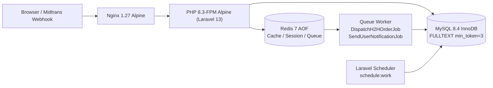
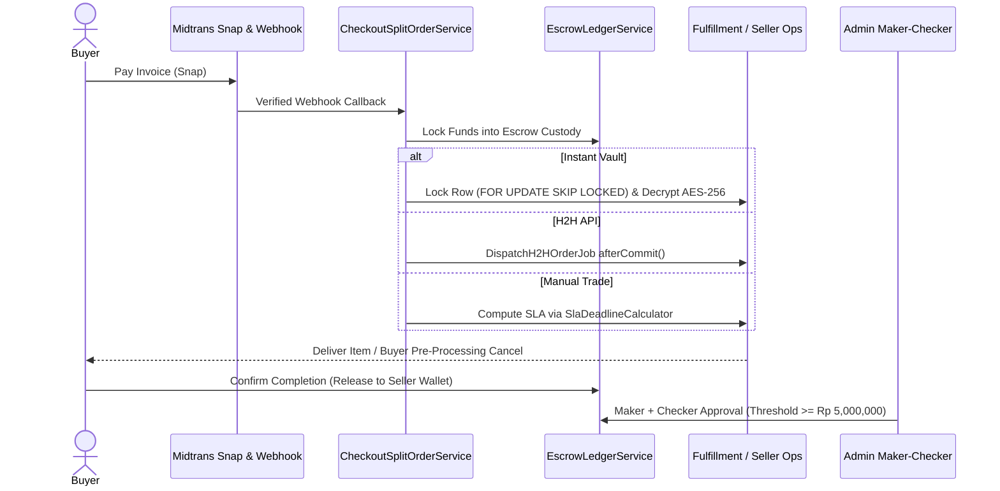

<div align="center">

# Latata — Digital Goods Marketplace Engine

**Production-grade Laravel 13 & MySQL 8.4 InnoDB backend for digital goods trading, engineered around double-entry escrow accounting, concurrency-safe vault fulfillment, multi-layer anti-fraud governance, parallel stress-testing, and containerized CI/CD.**

[](https://github.com/Bagaspujiferian/latata/actions/workflows/ci.yml)


-4CAF50)
-2EA44F)


</div>

---

## Verified Engineering Quality Gates

Every push and pull request to `main` is automatically verified on Linux runners via [`.github/workflows/ci.yml`](.github/workflows/ci.yml):

| Gate | Tool / Verification | Verified Status |
| :--- | :--- | :--- |
| **Code Style** | `vendor/bin/pint --test` | PASS |
| **Static Analysis** | Larastan / PHPStan Level 8 (`--memory-limit=1G`) | PASS (`0 errors`) |
| **N+1 Query Protection** | `Model::preventLazyLoading(! app()->isProduction())` | Enabled globally |
| **Automated Test Suite** | `php artisan test` against live **MySQL 8.4 InnoDB** | **98/98 passed** (`1,602 assertions`) |
| **Parallel HTTP Stress Test** | `php artisan nexatrade:stress-test --concurrency=30` (`curl_multi`) | **3/3 PASS** (`0 HTTP 500`, `0 deadlocks`) |
| **Ledger Reconciliation** | `php artisan migrate:fresh --seed` + `php artisan nexatrade:audit-ledger` | **`[BALANCED]`** (`Discrepancy = Rp 0,00`) |
| **Container Build Check** | `docker compose config --quiet` + multi-stage `Dockerfile` build | PASS |

---

## Parallel HTTP Concurrency Benchmark (`curl_multi`)

Sequential PHPUnit tests cannot expose true multi-connection race conditions or InnoDB `REPEATABLE READ` MVCC snapshot anomalies. `php artisan nexatrade:stress-test` fires simultaneous HTTP waves via native `curl_multi` against a live MySQL 8.4 InnoDB instance:

| Scenario | Concurrent Requests | Succeeded | Safely Rejected | HTTP 500 / Errors | Domain Invariant | Result |
| :--- | :---: | :---: | :---: | :---: | :--- | :---: |
| **A. Instant Vault `SKIP LOCKED`** | 30 | 5 | 25 (`422`) | 0 | `Orders=5/5, UniqueVaults=5/5, Stock=0` | **PASS** |
| **B. HTTP Idempotency Race** | 20 | 1 | 19 (`409`) | 0 | `PaidInvoices=1/1, WalletDebits=1/1` | **PASS** |
| **C. Flash Sale Quota Contention** | 25 | 3 | 22 (`422`) | 0 | `FlashSold=3/3, PromoItems=3/3` | **PASS** |

> Post-attack audit: **`[BALANCED]` (`Discrepancy = Rp 0,00`)** across all custody wallets and double-entry ledger mutations.

---

## Core System Architecture

### 1. Infrastructure & Async Worker Topology



### 2. Escrow Fulfillment & Maker-Checker Payout Flow



---

## Security, Anti-Fraud & Accounting Controls

| Domain | Mechanism Implemented | Key Components |
| :--- | :--- | :--- |
| **Double-Entry Custody** | Balanced wallet & mutation tracking with CLI global reconciliation and True Net Operating Profit (MDR-adjusted P&L without mutating custody balances) | `EscrowLedgerService`, `php artisan nexatrade:audit-ledger` |
| **Concurrency & Locking** | Atomic `FOR UPDATE SKIP LOCKED` vault allocation, InnoDB Current Read (`lockForUpdate()`) stock sync under `REPEATABLE READ`, ordered wallet locks, and `->afterCommit()` async jobs | `CheckoutSplitOrderService`, `VaultEncryptionService`, `DispatchH2HOrderJob` |
| **Anti-Bot & Anti-Mule** | Email + unique phone OTP verification using HMAC-SHA256 `phone_blind_hash` and KYC legal name vs. bank account holder fuzzy verification | `VerificationChannel`, `IndonesianNameMatcher`, `user_verification_challenges` |
| **Internal Governance** | Granular 4-subrole Admin RBAC and Four-Eyes Maker-Checker withdrawal approval (`>= Rp 5.000.000`) enforced by InnoDB unique constraints | `AdminSubrole`, `WithdrawalApprovalStage` |
| **Seller Operations & Vault** | Store Vacation Mode guard, SLA-aware operating hours (`store_operating_hours`), AES-256 bulk vault importer (500 lines/batch + global blind-hash dedup), and buyer pre-processing cancel with anti-voucher-farming refund precision | `SlaDeadlineCalculator`, `VaultBulkImportService`, `ManualOrderCancellationService`, `StateTransitionGuard` |
| **Catalog Search & Monitoring** | MySQL InnoDB `FULLTEXT` Boolean Mode search with safe `LIKE` fallback for short queries (`< 3` chars), plus scheduled worker heartbeat monitoring at `/admin/finance` | `FulltextQuerySanitizer`, `ProductCatalogFilterService`, `scheduler_heartbeats` |

---

## Quickstart

### Option A — Production-Like Docker Stack (6 Services)

Runs `app` (non-root PHP 8.3-FPM), `nginx`, `mysql:8.4` (`--innodb-ft-min-token-size=3`), `redis:7`, `queue`, and `scheduler`:

```bash
cp .env.docker.example .env.docker
docker compose up -d --build
docker compose exec app php artisan key:generate
docker compose exec app php artisan migrate:fresh --seed --force
docker compose exec app php artisan nexatrade:audit-ledger
```

Open `http://localhost:8080`.

### Option B — Local Development (Laragon / PHP 8.3 + MySQL 8.4)

1. Create two MySQL 8.4 databases: `db_latata` (development) and `db_latata_test` (PHPUnit).
2. Install dependencies, compile assets, and bootstrap the database:

```bash
composer install
npm ci && npm run build
cp .env.example .env
php artisan key:generate
php artisan migrate:fresh --seed
```

3. Run all quality gates & parallel concurrency stress-test locally:

```bash
vendor/bin/pint --test
vendor/bin/phpstan analyse --memory-limit=1G
php artisan test
php artisan nexatrade:stress-test --url=[http://latata.test](http://latata.test) --concurrency=30
php artisan nexatrade:audit-ledger
```

### Midtrans Sandbox Webhook Testing (Local)

Expose your local virtual host via Cloudflare Tunnel when testing real Midtrans Snap callbacks (`NEXATRADE_PAYMENT_DRIVER=midtrans_sandbox`):

```bash
cloudflared tunnel --url [http://latata.test](http://latata.test) --http-host-header latata.test
```

---

## Project Layout

```text
├── .github/workflows/ci.yml   # GitHub Actions (Pint, PHPStan Lv8, MySQL 8.4 Tests, Docker Build)
├── docker/                    # Nginx vhost, PHP/OPcache production configs, container entrypoint
├── docker-compose.yml         # 6-service stack (app, nginx, mysql 8.4, redis 7, queue, scheduler)
├── Dockerfile                 # Multi-stage build (Node 22 + Composer 2 + PHP 8.3-FPM Alpine)
├── app/
│   ├── Console/Commands/      # Scheduled jobs, audit-ledger CLI, and curl_multi stress-tester
│   ├── Data/                  # Immutable readonly DTOs (e.g. BulkVaultImportResult)
│   ├── Enums/                 # Strict domain enums (AdminSubrole, WithdrawalApprovalStage, etc.)
│   ├── Exceptions/            # Explicit domain exceptions (StoreOnVacationException, etc.)
│   ├── Jobs/                  # After-commit async jobs (DispatchH2HOrderJob, SendUserNotificationJob)
│   ├── Services/              # Focused domain services (Escrow, SLA, Vault, Fulltext, Midtrans)
│   └── Support/               # State machine guards & domain helpers
├── database/migrations/       # Additive MySQL 8.4 InnoDB schema & FULLTEXT indexes
├── docs/                      # Phase-by-phase engineering PRDs & hardening checklists
└── tests/                     # 98 Unit & Feature tests running against real MySQL 8.4 InnoDB
```

---

## License

Built for engineering architecture demonstration and portfolio showcase under the [MIT License](https://opensource.org/licenses/MIT).